# BalanceVault

**Snovasys Fresher Hiring Challenge**

BalanceVault is a full-stack banking and ledger application built as a hiring-challenge project. It provides account registration and login, customer accounts, account-to-account transfers, and transaction history through a React web application backed by an Express API and PostgreSQL.

> **Project status:** Core authentication, account, transfer, authorization, and ledger flows are implemented and covered by automated tests. This is a challenge/demo application, not a production banking platform or a connection to a payment network.

## Features implemented

- Register account-holder users and sign in with email and password.
- Hash passwords with bcrypt and issue short-lived JWT sessions in HttpOnly cookies.
- Authenticate API requests and enforce account-holder and administrator roles on the backend.
- Create accounts, list and view accounts, and restrict account-holder queries to accounts they own.
- Create accounts in `PENDING` status; administrators can activate, freeze, or close accounts according to allowed transitions.
- Transfer between active accounts of the same currency using PostgreSQL transactions, account row locks, and serializable isolation.
- Reject invalid amounts and insufficient funds; update both account balances together.
- Write equal `DEBIT` and `CREDIT` ledger entries for a completed transfer.
- Support idempotent transfer requests using an idempotency key scoped to the requesting user.
- Record registration, login, account creation, account-status changes, and completed transfers in the audit log.
- Show account balances, activity, profile information, and administrator views in a responsive React interface.

## Technology stack

| Area | Technologies |
|---|---|
| Frontend | React 19, Vite 8, JavaScript, CSS |
| Backend | Node.js, Express 5 |
| Database | PostgreSQL (configured for Neon through a PostgreSQL connection URL) |
| ORM | Prisma 7 with the PostgreSQL driver adapter |
| Authentication | JSON Web Tokens, bcryptjs, HttpOnly cookies |
| Validation and security | Zod, Helmet, CORS, express-rate-limit |
| Tests | Node.js built-in test runner, isolated test doubles, PostgreSQL integration tests |

## Project structure

```text
BalanceVault/
├── README.md
├── package.json                  # Root convenience scripts
├── backend/
│   ├── app.js                    # Express app and route mounting
│   ├── server.js                 # API entry point (default port 5000)
│   ├── lib/
│   │   ├── audit.js              # Audit-log helper
│   │   ├── prisma.js             # Prisma client using DATABASE_URL
│   │   └── transfers.js          # Atomic transfer and ledger service
│   ├── middleware/
│   │   └── auth.js               # JWT authentication and role checks
│   ├── prisma/
│   │   ├── schema.prisma         # PostgreSQL data model
│   │   └── migrations/           # Checked-in database migrations
│   ├── routes/
│   │   ├── accounts.js
│   │   ├── admin.js
│   │   ├── auth.js
│   │   └── transfers.js
│   ├── scripts/
│   │   ├── promote-admin.js
│   │   └── verify-test-database.js
│   └── test/
│       ├── accounts.test.js
│       ├── auth.test.js
│       ├── transfers.test.js
│       ├── transfers.postgres.test.js
│       └── helpers/test-database.js
└── frontend/
    ├── index.html
    ├── vite.config.js
    └── src/
        ├── api.js                # Credentialed API client
        ├── App.jsx               # Application screens and flows
        ├── App.css
        ├── index.css
        └── api.test.js
```

Generated Prisma client files, installed dependencies, and build output are omitted from this overview.

## Architecture

The browser application sends JSON requests to the Express API. The frontend includes credentials with requests so the browser can send the API's HttpOnly session cookie. The API validates request data, authenticates the current user, applies role and ownership rules, and uses Prisma to access PostgreSQL.

```mermaid
flowchart LR
    User[User in browser] --> UI[React + Vite]
    UI -->|HTTP JSON + session cookie| API[Express API]
    API --> Auth[JWT auth and role middleware]
    API --> Routes[Auth, account, transfer, admin routes]
    Routes --> Services[Prisma and transfer/audit services]
    Services --> DB[(PostgreSQL / Neon)]
```



The transfer service performs the transfer record, balance changes, ledger entries, idempotency response, and audit write in one database transaction. A failure during those writes rolls back the transaction. Concurrent serialization conflicts from PostgreSQL are retried a limited number of times; unresolved conflicts return a conflict response.

## Database model

The Prisma schema is in `backend/prisma/schema.prisma`. The existing migration is in `backend/prisma/migrations/`.

| Model | Purpose |
|---|---|
| `User` | Account-holder or administrator identity, password hash, and account ownership. |
| `Account` | Unique account number, owner, decimal balance, currency, and `PENDING` / `ACTIVE` / `FROZEN` / `CLOSED` status. |
| `Transfer` | Source and destination accounts, amount, currency, status, description, and creation time. |
| `LedgerEntry` | A debit or credit entry tied to a transfer and account. A completed transfer writes one of each for the same amount. |
| `IdempotencyKey` | User-scoped request key, request hash, and saved response used to safely replay transfer requests. |
| `AuditLog` | Actor, action, affected entity, optional details, IP address, and timestamp. |

Account balances use PostgreSQL `DECIMAL(18,2)`. The schema relates transfers to both accounts and relates ledger entries to transfers and accounts.

## API overview

All API paths are prefixed with `/api`.

| Method | Path | Purpose |
|---|---|---|
| `GET` | `/health` | API health check. |
| `POST` | `/auth/register` | Register an account holder. Public registration cannot select the administrator role. |
| `POST` | `/auth/login` | Sign in and receive an HttpOnly session cookie. |
| `POST` | `/auth/logout` | Clear the session cookie. |
| `GET` | `/auth/me` | Return the authenticated user's profile. |
| `GET`, `POST` | `/accounts` | List accessible accounts or create an account. |
| `GET` | `/accounts/:accountId` | Read an account and recent ledger entries, subject to ownership/admin authorization. |
| `POST` | `/transfers` | Initiate a transfer; requires an `Idempotency-Key` header and an account-holder session. |
| `GET` | `/transfers` | List accessible transfer history. |
| `GET` | `/transfers/:transferId` | Read an accessible transfer and its ledger entries. |
| `GET` | `/admin/overview`, `/admin/users`, `/admin/transfers`, `/admin/audit-logs` | Administrator summaries and operational lists. |
| `PATCH` | `/admin/accounts/:accountId/status` | Administrator-only account status transition. |

The backend is the authorization boundary. Hiding an administrator screen in the frontend does not grant or deny API permissions.

## Windows PowerShell setup

### Prerequisites

- A supported Node.js installation and npm.
- A PostgreSQL database for development. The application can use a Neon PostgreSQL database.
- A **separate** PostgreSQL database or Neon branch for destructive integration tests.

### 1. Install dependencies

Open PowerShell in the project root:

```powershell
Set-Location 'C:\path\to\BalanceVault'
Set-Location .\backend
npm.cmd ci

Set-Location ..\frontend
npm.cmd ci
```

The root package is a script aggregator; dependencies are installed separately for `backend` and `frontend`.

### 2. Configure backend environment

Create `backend\.env` locally. Do not commit it or share its contents:

```dotenv
DATABASE_URL="<development PostgreSQL connection URL>"
JWT_SECRET="<long, random, private signing secret>"
PORT=5000
FRONTEND_URL="http://localhost:5173"
TRUST_PROXY=false
```

`DATABASE_URL` is used by the backend Prisma client and Prisma CLI. `JWT_SECRET` is required for registration and login. `PORT`, `FRONTEND_URL`, and `TRUST_PROXY` are optional; the values shown are suitable for local development.

### 3. Generate Prisma Client and apply migrations

From `backend`:

```powershell
Set-Location 'C:\path\to\BalanceVault\backend'
npm.cmd exec prisma generate
npm.cmd exec prisma migrate deploy
```

`migrate deploy` applies checked-in migrations to the database selected by `DATABASE_URL`; verify that URL before running it. Do not use database reset commands on any database containing records you need to preserve.

### 4. Configure the frontend

The frontend defaults to `http://localhost:5000/api`. To use another API address, create `frontend\.env.local`:

```dotenv
VITE_API_URL="http://localhost:5000/api"
```

### 5. Run the application

Use two PowerShell windows.

Backend:

```powershell
Set-Location 'C:\path\to\BalanceVault\backend'
npm.cmd run dev
```

Frontend:

```powershell
Set-Location 'C:\path\to\BalanceVault\frontend'
npm.cmd run dev
```

Open the Vite URL shown in the frontend terminal (normally `http://localhost:5173`). The backend health check is at `http://localhost:5000/api/health`.

### Administrator provisioning

Public registration only creates account holders. To grant administrator access to an existing account, run this deliberate database-writing command from `backend`:

```powershell
npm.cmd run admin:promote -- existing-user@example.com
```

It updates that user's role and writes an audit event. Use only with a reviewed account and the intended development database.

## Environment variables

| Variable | Required | Purpose |
|---|---:|---|
| `DATABASE_URL` | Yes for backend/database CLI | Development/runtime PostgreSQL connection URL. |
| `JWT_SECRET` | Yes for authentication | Private key used to sign session JWTs. |
| `PORT` | No | API port; defaults to `5000`. |
| `FRONTEND_URL` | No | Allowed frontend origin; defaults to `http://localhost:5173`. |
| `TRUST_PROXY` | No | Set to `true` only when deployed behind a correctly configured trusted proxy. Defaults to `false`. |
| `VITE_API_URL` | No | Frontend API base URL; defaults to `http://localhost:5000/api`. |
| `TEST_DATABASE_URL` | Yes for PostgreSQL transfer integration tests | Dedicated test-only PostgreSQL connection URL. Must not point to the same database as `DATABASE_URL`. |

The test database URL belongs in the ignored `backend\.env.test` file:

```dotenv
TEST_DATABASE_URL="<separate test-only PostgreSQL connection URL>"
```

The test harness refuses to run if that variable is missing, if the development `DATABASE_URL` cannot be read for the separation check, or if both URLs resolve to the same database identity. It checks connectivity and required tables using read-only queries before running tests. Never use your development/production URL as `TEST_DATABASE_URL`.

## Tests and verification

From the project root:

```powershell
npm.cmd test
npm.cmd run lint
npm.cmd run build
```

- `npm.cmd test` runs backend unit/API tests with isolated in-memory test doubles, followed by frontend API-client tests.
- `npm.cmd run lint` runs Oxlint on the frontend.
- `npm.cmd run build` creates the Vite production build in `frontend\dist`.

PostgreSQL transfer integration tests are a separate command and require the dedicated test database above:

```powershell
Set-Location 'C:\path\to\BalanceVault\backend'
npm.cmd run test:db:verify
npm.cmd run test:integration:transfers
```

The integration command repeats the safety verification before running. Its cases cover:

1. Successful source debit, destination credit, and equal debit/credit ledger entries.
2. Insufficient-funds rejection with no partial transfer, balance, ledger, idempotency, or audit changes.
3. Idempotent retry without creating a second transfer.
4. Concurrent transfers without a negative balance or duplicate ledger transfer.
5. Transaction rollback if the audit write fails.

The suite creates unique test users and accounts and deletes only records identified by that fixture. Do not point it at a database containing production or valuable development data.

### Last recorded verification

- Backend unit/API tests: 12 passed.
- Frontend API-client tests: 2 passed.
- PostgreSQL transfer integration tests: 5 passed.
- Frontend lint: 0 warnings and 0 errors.
- Frontend production build: passed.
- Prisma Client generation: passed.

These are development-time results, not a guarantee about another machine, database, or later code revision. The test suite does not replace an independent financial or security audit.

## Current limitations

- This application does not connect to real banks, payment processors, card networks, or external money-transfer rails. Transfers update this application's own database only.
- An account-holder's new account starts as `PENDING` and needs an administrator to activate it before it can send or receive transfers.
- Currency matching is required for transfers; currency conversion is not implemented.
- Password reset, email verification, multi-factor authentication, profile editing, and self-service account closure are not implemented.
- Session logout clears the browser cookie; there is no server-side token revocation list. A previously copied, unexpired bearer token would remain valid until expiry.
- Audit logging covers key successful operations, but not every read or every denied/failed action.
- Ledger entries are written transactionally, but the schema does not yet enforce ledger immutability or debit/credit balancing with database constraints or triggers.
- PostgreSQL concurrency behavior is integration-tested, but these tests are not a formal load, disaster-recovery, or accounting certification.
- Deployment infrastructure, CI/CD, production monitoring, backups, and operational runbooks are not included.

